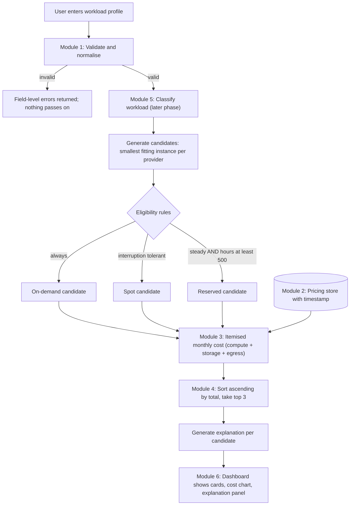
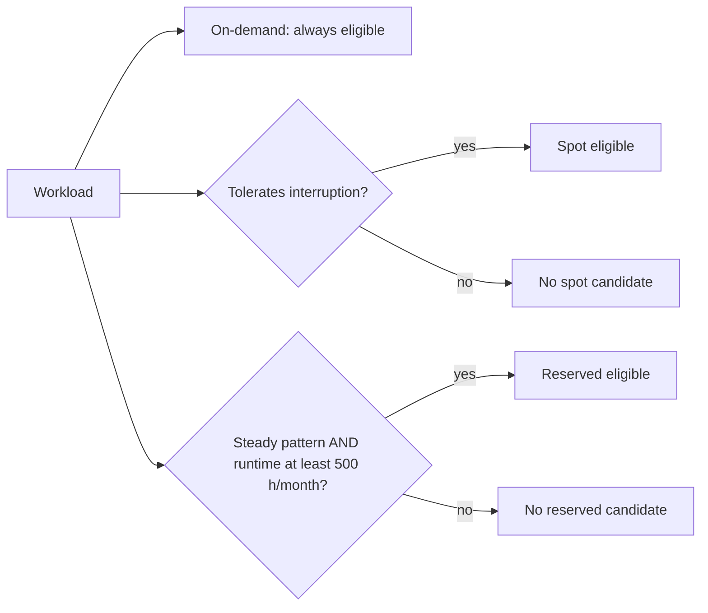
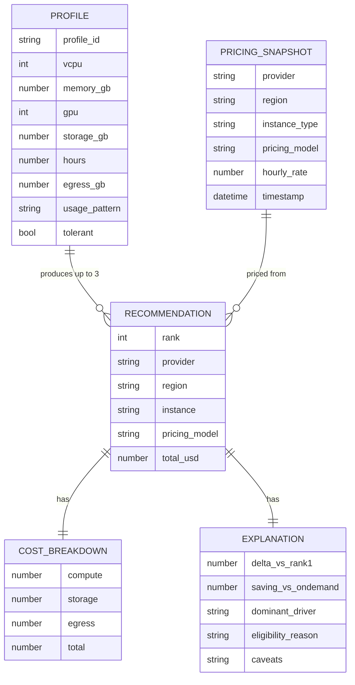
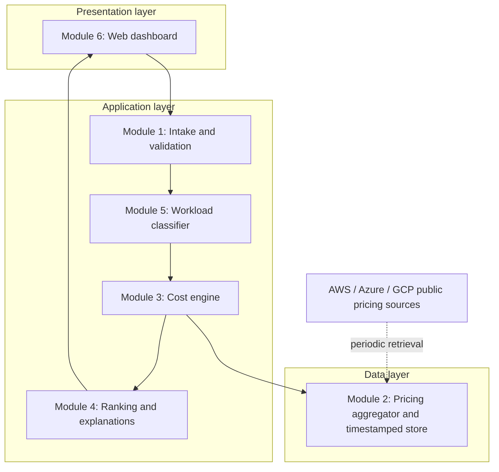
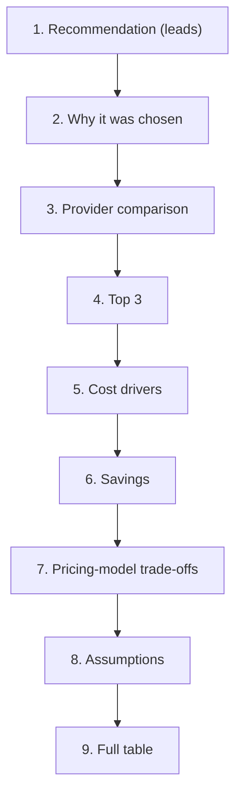

# Explainable Multi-Cloud Advisor for Choosing Cloud Providers and Pricing Models Before Deployment

> **What this document is:** a requirements-level README describing what the project is *supposed* to do, reconstructed from the messages and documents supplied by the project owner's friend.
> **What it is not:** an implementation review. Nothing here states whether the existing code meets a requirement. Use it later as the checklist to compare against the code.

---

## Table of Contents

1. [Project at a Glance](#1-project-at-a-glance)
2. [Sources and Status Legend](#2-sources-and-status-legend)
3. [Problem, Objectives and Novelty](#3-problem-objectives-and-novelty)
4. [Scope, Users and Deliverables](#4-scope-users-and-deliverables)
5. [How the System Is Expected to Work](#5-how-the-system-is-expected-to-work)
6. [Functional Requirements](#6-functional-requirements)
7. [Data Requirements](#7-data-requirements)
8. [Cost Model and Ranking Rules](#8-cost-model-and-ranking-rules)
9. [Architecture](#9-architecture)
10. [System and Software Requirements](#10-system-and-software-requirements)
11. [Cloud Infrastructure Requirements](#11-cloud-infrastructure-requirements)
12. [Security and Privacy Requirements](#12-security-and-privacy-requirements)
13. [Non-Functional Requirements](#13-non-functional-requirements)
14. [Frontend and UX Requirements](#14-frontend-and-ux-requirements)
15. [Testing and Acceptance Criteria](#15-testing-and-acceptance-criteria)
16. [Deployment and Operational Requirements](#16-deployment-and-operational-requirements)
17. [Constraints, Assumptions and Dependencies](#17-constraints-assumptions-and-dependencies)
18. [Contradictions Found Between Sources](#18-contradictions-found-between-sources)
19. [Confirmed vs Assumed vs Needs Clarification](#19-confirmed-vs-assumed-vs-needs-clarification)
20. [Prioritized Questions for the Project Owner](#20-prioritized-questions-for-the-project-owner)
21. [Requirement Traceability Summary](#21-requirement-traceability-summary)
22. [Related Idea Outside This Project](#22-related-idea-outside-this-project)
23. [Glossary](#23-glossary)
24. [Verification Checklist for the Later Code Review](#24-verification-checklist-for-the-later-code-review)

---

## 1. Project at a Glance

**In one sentence:** before anyone deploys a workload, the user describes it (CPU, memory, GPU, storage, runtime, data transfer, usage pattern, interruption tolerance), and the system compares AWS, Azure and GCP across on-demand, spot and reserved pricing, then recommends the cheapest placement and explains, item by item, why.

| Question | Short answer |
|---|---|
| What is it? | A **pre-deployment**, **explainable**, **multi-cloud** workload placement advisor. |
| Why is it needed? | Providers name and price comparable resources differently. Spot and reserved options carry trade-offs. Egress and storage costs are easy to overlook. Existing cost tools mostly analyse bills of workloads that already run. |
| Who uses it? | Students, start-ups, small dev teams and non-expert decision makers without a cloud-economics specialist. |
| What goes in? | A workload profile. |
| What comes out? | A ranked top-3 list of provider / region / instance / pricing-model placements, each with an itemised monthly cost and a plain-language explanation. |
| What makes it different? | Every recommendation is a transparent calculation traceable to the profile and a dated pricing snapshot. No black-box score and no post-hoc explainers such as SHAP or LIME. |
| Final deliverable | A working advisor (backend + dashboard), a pricing dataset, tests, and a project report (the report exists as a source document). |

> **Important distinction:** this is a *tool that advises about clouds*. The documents do **not** say the tool itself must be hosted on a cloud. See [Section 11](#11-cloud-infrastructure-requirements).

---

## 2. Sources and Status Legend

### Source documents

| Ref | Document | What it contributes |
|---|---|---|
| **S1** | Frontend redesign conversation (pasted spec header, two follow-up status messages, "Cloud advisor redesigned" zip). The full 64-section frontend spec is **not included**, only its title, section numbers (§) and what the follow-up messages say about it. | Frontend/UX requirements |
| **S2** | Build plan and project explanation (module build order, Flask + JSON/CSV starter code, research gap, novelty, "Multi-Cloud Cost Optimization" project description). | Intake and pricing modules, tech stack, novelty |
| **S3** | Project report (abstract, chapters 1-7, appendix, references). | Most detailed source: problem, formulas, rules, tests, sample data, results |
| **S4** | Brief asking for a requirements analysis. | Method only; no project requirements |

### Status legend

| Status | Meaning |
|---|---|
| **Confirmed** | Explicitly stated in a source. |
| **Inferred** | Reasonably implied but not stated; treat as an assumption until the owner confirms. |
| **Needs Clarification** | Missing, ambiguous or contradictory. |
| **Recommended** | Good practice suggested by this README, **not** requested by the owner. |

> Where a requirement is marked Confirmed from **S1** and refers to a § number, the original spec text was not available. Re-check it against the original spec.

---

## 3. Problem, Objectives and Novelty

### 3.1 Problem statement (S2, S3)

Organisations usually pick a cloud provider, region and pricing model by habit, existing contracts or manual estimation. Four things make a fair comparison hard:

| Difficulty | Explanation |
|---|---|
| Heterogeneous pricing | Providers use different formats, units, granularity and instance names. |
| Hidden cost components | Storage and data egress can dominate a bill and are priced differently per provider. |
| Commitment vs risk | Reserved capacity is billed for the whole month; spot capacity can be interrupted. |
| Lack of explanation | A bare price gives no way to judge fit or sensitivity to assumptions. |

Moving a workload after deployment is expensive (migration, reconfiguration, downtime), so the cheapest moment to decide is before provisioning (S3 §1.1).

### 3.2 Objectives

| ID | Objective | Source | Status |
|---|---|---|---|
| OBJ-01 | Define a structured workload profile (CPU, memory, GPU, storage, runtime, data transfer, usage pattern, interruption tolerance). | S3 §1.2 | Confirmed |
| OBJ-02 | Collect and normalise AWS, Azure and GCP pricing into one schema (instances, storage, data transfer). | S3 §1.2 | Confirmed |
| OBJ-03 | Compute itemised monthly cost (compute, storage, egress) for on-demand, spot and reserved, with explicit eligibility rules. | S3 §1.2 | Confirmed |
| OBJ-04 | Rank candidates and return the top three with a cost breakdown and comparative explanation. | S3 §1.2 | Confirmed |
| OBJ-05 | Classify the workload with an ML model so sensible pricing strategies can be suggested for incompletely specified workloads. | S3 §1.2; S2 | Confirmed (as later/add-on work, see FR-CLS) |
| OBJ-06 | Present profile entry, ranked results and explanations through an interactive dashboard. | S3 §1.2 | Confirmed |
| OBJ-07 | Evaluate against baselines (always-AWS, cheapest-on-demand-only, random/round-robin) using historical pricing and public traces. | S2 (Objective 6) | Confirmed in S2; **not carried into S3** (S3 uses cheapest on-demand only). See Q-14. |

### 3.3 Research gap and novelty (S2)

- **Gap:** pre-deployment placement recommendation exists (Cloud Service Brokerage). What is underexplored is recommendation with *auditable reasoning* applied to *modern spot / reserved / on-demand complexity*.
- **Novelty claims:** (1) explainability by construction through an itemised cost breakdown; (2) comparative top-3 reasoning with trade-off statements; (3) a deterministic cost core with one narrow ML component (workload-pattern classifier) on top.
- **Base paper (S3):** Tan et al. 2025, *Cost-Aware Operator Migration for Distributed Stream Processing*, IEEE TCC 13(1). The project adopts its cost-first philosophy for a different decision (initial placement).

---

## 4. Scope, Users and Deliverables

### 4.1 In scope

| Item | Source | Status |
|---|---|---|
| Providers: AWS, Azure, GCP | S2, S3 | Confirmed |
| Pricing models: on-demand, spot, reserved | S2, S3 | Confirmed |
| Cost components: compute, storage, data egress | S3 | Confirmed |
| Core pipeline Modules 1-4 (intake, pricing, cost engine, recommendation) | S3 Ch. 5-6 | Confirmed |
| Dashboard / web UI | S2, S3, S1 | Confirmed |
| Workload classifier (Module 5) | S2, S3 | Confirmed, but sequenced after the core pipeline |
| Multi-region comparison | S1 (regions from pricing data) | Inferred; S3 assumes **one region** |

### 4.2 Out of scope or explicitly limited (S3 §6.3.4, §7.3)

Live provider API integration, tiered egress and free allowances, multi-year commitments, spot-price volatility modelling, performance-normalised cost, multi-instance / containerised / autoscaled workloads, infrastructure-as-code integration, validation against real bills. These are listed as **future work**. S1 also says optimizer extras (3-year commitments, right-sizing, extra services) are *not in the spec*.

### 4.3 Stakeholders and users

| Role | Description | Source | Status |
|---|---|---|---|
| Workload owner / engineer | Enters a profile and reads the recommendation. | S3 | Confirmed |
| Non-expert decision maker | Needs plain-language justification. | S2 | Confirmed |
| Students / researchers | Evaluate the transparent-reasoning hypothesis. | S2 | Confirmed |
| Administrator / pricing data maintainer | Refreshes the pricing snapshot. | none | Inferred: someone must maintain pricing. Needs clarification |
| Authenticated user accounts, roles, permissions | Not mentioned | none | **Not specified** |

### 4.4 Expected deliverables

| # | Deliverable | Source | Status |
|---|---|---|---|
| D1 | Backend (Flask API) with intake, pricing, cost engine, recommendation engine | S2, S1 | Confirmed |
| D2 | Pricing dataset (CSV/JSON/SQLite) with dated records | S2, S3 | Confirmed |
| D3 | Dashboard / frontend | S2, S3, S1 | Confirmed |
| D4 | Workload classifier (add-on) | S2, S3 | Confirmed (later phase) |
| D5 | Automated tests, including the hand-calculated cases | S3 Ch. 5 | Confirmed |
| D6 | Project report with results and references | S3 | Confirmed (exists) |
| D7 | Initial plan kept in PPT | S2 ("Leave our initial plan in ppt") | Confirmed |
| D8 | Exports: CSV and PDF of results | S1 | Confirmed |
| D9 | Deployment package / hosting | none | **Not specified** |

---

## 5. How the System Is Expected to Work

### 5.1 Plain-language walk-through

1. You describe the workload you plan to run.
2. The system checks the input and rejects impossible values.
3. For each provider it finds the smallest instance that fits your CPU, memory and GPU needs.
4. It decides which pricing models are *allowed* for your workload: spot only if you tolerate interruptions; reserved only for steady workloads running long enough.
5. It computes monthly compute + storage + egress for every allowed combination.
6. It sorts by total cost, returns the top three, and writes a plain-language explanation tied to the numbers.

### 5.2 End-to-end flow



### 5.3 Pricing-model eligibility decision



---

## 6. Functional Requirements

### 6.1 Module 1: Workload Profile Intake and Validation

| ID | Requirement | Source | Status | Acceptance criterion |
|---|---|---|---|---|
| FR-INT-01 | Accept a workload profile through a form and/or a JSON/config file. | S3 §1.5.1, §4.3.1; S2 | Confirmed | Valid profile submitted by either route is accepted. |
| FR-INT-02 | Capture the eight core fields: vCPU, memory (GB), GPU count, storage (GB), runtime (hours/month), data transfer out (GB/month), usage pattern, interruption tolerance. | S3 Table 4.1 | Confirmed | All eight stored and passed on. |
| FR-INT-03 | Also capture `storage_type` (SSD/HDD), GPU type when GPU required, and data transfer **in and out separately**. | S2 | Confirmed in S2; absent from S3 | Fields exist, or owner confirms they are dropped (Q-06). |
| FR-INT-04 | Validate: vCPU positive integer; memory positive number; GPU non-negative integer; storage and egress non-negative; runtime > 0 and ≤ 730; interruption tolerance boolean. | S3 Table 4.1, Listing 7.1 | Confirmed | UT-01 to UT-03 pass. |
| FR-INT-05 | Usage pattern drawn from a fixed list. | S3 Table 4.1 (steady / periodic / bursty); S2 (steady-state / bursty / batch-scheduled / gpu-intensive) | **Needs Clarification** | Single agreed value list (Q-05). |
| FR-INT-06 | If GPU required, GPU type is mandatory. | S2 starter code | Confirmed | Missing GPU type yields an error. |
| FR-INT-07 | On any validation failure return field-level messages and pass nothing downstream. | S3 §4.3.1, ST-04 | Confirmed | Incomplete profile is rejected with field-level messages. |
| FR-INT-08 | GPU count > 0 restricts candidates to GPU instance families. | S3 §4.3.1 | Confirmed | IT-01 passes. |
| FR-INT-09 | Persist profiles (JSON file or SQLite row) and retrieve by ID. | S2 | Confirmed that *some* storage is needed; mechanism **Needs Clarification** | POST then GET returns the stored profile. |
| FR-INT-10 | Normalise input to an internal representation. | S3 §1.5.1 | Confirmed | Output matches schema in Section 7.1. |

### 6.2 Module 2: Multi-Cloud Pricing Aggregator

| ID | Requirement | Source | Status | Acceptance criterion |
|---|---|---|---|---|
| FR-PRC-01 | Hold normalised pricing for AWS, Azure and GCP in one unified schema (Section 7.2). | S3 §4.3.2 | Confirmed | Records from all three providers share the schema. |
| FR-PRC-02 | Cover on-demand, spot/preemptible and reserved/committed pricing. | S2, S3 | Confirmed | Each pricing model present for comparable instances. |
| FR-PRC-03 | Cover a small fixed set of comparable instances (about 5-8 tiers per provider), not every SKU. | S2 | Confirmed for the prototype | Dataset includes the tiers listed in S3 Table 6.2 at minimum. |
| FR-PRC-04 | Data source: static/hand-entered table for the prototype; live pulls from AWS Price List, Azure Retail Prices API, GCP Cloud Billing Catalog API are a later option. | S2 ("static/refreshable"), S3 §4.3.2 (fetches via APIs), §7.3 (live APIs = future work) | **Needs Clarification** (Q-04) | Owner states static vs live. |
| FR-PRC-05 | Timestamp every record or snapshot; every recommendation traceable to a snapshot; data age reportable. | S3 §1.5.2, §3.2, §4.3.2 | Confirmed | Result shows pricing date. |
| FR-PRC-06 | Convert to USD and a common billing unit; skip and log records with missing or non-numeric price. | S3 §4.3.2 | Confirmed | Bad records excluded and logged. |
| FR-PRC-07 | Cost engine reads only from the cache/store, not from provider interfaces at request time. | S3 §4.3.2, §4.4 | Confirmed | No outbound provider call in the request path. |
| FR-PRC-08 | Queryable: given vCPU/RAM (and GPU) requirements, return matching instances across providers with prices. | S2 | Confirmed | `find_matches`-style query returns expected rows. |
| FR-PRC-09 | Storage rate and egress rate per provider are part of the pricing data. | S3 Table 6.2; S2 | Confirmed | Rates present per provider. |
| FR-PRC-10 | Spot and reserved prices expressed as discount % vs explicit price per row. | S3 (discount %); S2 CSV (price per row) | **Needs Clarification** (Q-07) | Single representation agreed. |
| FR-PRC-11 | Region field present per record. | S2 schema; S3 (schema lists region, but assumes one region) | Confirmed in schema; multi-region behaviour **Needs Clarification** (Q-08) | |

### 6.3 Module 3: Cost Computation Engine

| ID | Requirement | Source | Status | Acceptance criterion |
|---|---|---|---|---|
| FR-CST-01 | For each provider pick the smallest catalogue instance meeting vCPU, memory and GPU. | S3 §4.3.3 | Confirmed | Selected instance is the minimal fit. |
| FR-CST-02 | Generate every eligible provider/pricing-model candidate (max 9 in S3 with one region). | S3 §4.4 | Confirmed | Candidate set matches rules in Section 8.2. |
| FR-CST-03 | Apply Equations 4.1-4.4 (Section 8). | S3 | Confirmed | UT-05 = USD 40.78. |
| FR-CST-04 | Return compute, storage and egress separately plus total, never just one number. | S3 §1.5.3; S2 | Confirmed | IT-02: components sum to total. |
| FR-CST-05 | Spot excluded for interruption-intolerant workloads. | S3 Table 4.2, ST-02 | Confirmed | No spot candidate in output. |
| FR-CST-06 | Reserved excluded unless steady AND runtime ≥ 500 h/month. | S3 Table 4.2, ST-03 | Confirmed | No reserved candidate for 100 h steady workload. |
| FR-CST-07 | A changed rate in the pricing store changes the computed cost. | S3 IT-01/IT-02 description | Confirmed | Integration test passes. |
| FR-CST-08 | Reservation term assumed 1 year. | S3 Table 6.2 | Confirmed for the sample; broader terms are future work | |

### 6.4 Module 4: Explainable Recommendation Engine

| ID | Requirement | Source | Status | Acceptance criterion |
|---|---|---|---|---|
| FR-REC-01 | Sort candidates ascending by total monthly cost. | S3 §4.3.4 | Confirmed | Output order verified. |
| FR-REC-02 | Return the top three. | S3, S2 | Confirmed | Three results (fewer only if fewer eligible). |
| FR-REC-03 | Per recommendation provide: itemised cost, difference from rank 1, saving vs cheapest on-demand, dominant cost driver, eligibility reason, caveats. | S3 §1.5.4, §4.3.4, Fig. 4.3 | Confirmed | All six present. |
| FR-REC-04 | Formulas: Δᵢ = (Cᵢ − C₁)/C₁ × 100; S = (C_od,min − C₁)/C_od,min × 100. | S3 §4.3.4 | Confirmed | Table 6.3/6.4 values reproduced. |
| FR-REC-05 | Candidates within 2% reported as "effectively tied". | S3 §4.3.4 | Confirmed | W2 ranks 1-2 (1.7%) flagged as tied. |
| FR-REC-06 | Spot caveat states the 10% interruption overhead assumption. | S3 §1.5.4, §4.3.4 | Confirmed | Caveat text present for spot. |
| FR-REC-07 | Trade-off statements between top options (e.g. "cheaper here, but reserved would win if this ran longer"). | S2 novelty | Confirmed | Comparative text present. |
| FR-REC-08 | No post-hoc explainer; explanation derived from cost components. | S2, S3 | Confirmed | Explanation text maps to computed numbers. |
| FR-REC-09 | Alternative labels for ranks 2 and 3. | S1 §29 (spec: fixed names); S1 says implementation uses data-driven labels | **Needs Clarification** (Q-12) | |

### 6.5 Module 5: Workload Pattern Classifier (add-on)

| ID | Requirement | Source | Status | Acceptance criterion |
|---|---|---|---|---|
| FR-CLS-01 | Sequence: built **after** the core pipeline and dashboard work with manual usage pattern selection. | S2 | Confirmed | Core pipeline works without classifier. |
| FR-CLS-02 | Classify into classes. S3: steady web service, batch processing, GPU/ML training, stateful/database, dev/test. S2: steady-state, bursty, batch, GPU-intensive. | S2, S3 | **Needs Clarification** (Q-05) | |
| FR-CLS-03 | Model: decision tree / random forest / light gradient boosting (S2); random forest (S3). | S2, S3 | Confirmed: random forest in S3 | |
| FR-CLS-04 | Training data: public cluster traces (Google Cluster Data, Azure Public Dataset) per S2; synthetic archetype data per S3. | S2 vs S3 | **Needs Clarification** (Q-09) | |
| FR-CLS-05 | Evaluate with stratified cross-validation, accuracy and macro-F1. | S3 §4.3.5 | Confirmed | Metrics reported. |
| FR-CLS-06 | Predicted class supplies a strategy prior and defaults for blank fields; it must **not** override eligibility rules. | S3 §4.3.5 | Confirmed | Eligibility unchanged by class. |
| FR-CLS-07 | Feature importance exposed for interpretation. | S3 §2.2.3 | Confirmed | |

### 6.6 Module 6: Dashboard (functional behaviour; UI detail in Section 14)

| ID | Requirement | Source | Status |
|---|---|---|---|
| FR-UI-01 | Profile form, three recommendation cards (first highlighted), itemised/stacked cost chart, explanation panel. | S3 §1.5.6, Fig. 3.3, §4.3.6 | Confirmed |
| FR-UI-02 | Recompute when an input changes (e.g. data transfer) so the user sees the ranking respond. | S3 §1.5.6, §4.3.6 | Confirmed |
| FR-UI-03 | Dashboard calls Modules 1-5 in sequence on submit. | S3 §4.3.6 | Confirmed |
| FR-UI-04 | Export results as PDF and CSV. | S1 | Confirmed |
| FR-UI-05 | Save analyses and list them under "My Analyses". | S1 (§53) | Confirmed that saving exists; **storage location Needs Clarification** (Q-11) |

---

## 7. Data Requirements

### 7.1 Workload profile schema

| Field | Type / unit | Rule | Source | Status |
|---|---|---|---|---|
| `vcpu` | integer | > 0 | S3 | Confirmed |
| `memory_gb` / `ram_gb` | number, GB | > 0 | S3, S2 | Confirmed (naming differs between sources) |
| `gpu` (count) | integer | ≥ 0 | S3 | Confirmed |
| `gpu_required` + `gpu_type` | bool + text | type required if true | S2 | Confirmed in S2 |
| `storage_gb` | number | ≥ 0 | S3, S2 | Confirmed |
| `storage_type` | SSD / HDD | | S2 | Confirmed in S2 |
| `hours` (runtime per month) | number | 0 < h ≤ 730 | S3 | Confirmed |
| `egress_gb` (data out) | number | ≥ 0 | S3 | Confirmed |
| `ingress_gb` (data in) | number | ≥ 0 | S2 | Confirmed in S2 |
| `usage_pattern` | category | see Q-05 | S2, S3 | Needs Clarification |
| `interruption_tolerant` | boolean | | S3 | Confirmed |
| `profile_id` | UUID | generated | S2 starter code | Inferred |
| region preference | text | from pricing data | S1 | Inferred |

### 7.2 Unified pricing record

| Field | Source | Status |
|---|---|---|
| provider (aws / azure / gcp) | S2, S3 | Confirmed |
| region | S2, S3 | Confirmed |
| instance_type | S2, S3 | Confirmed |
| vcpu, ram_gb | S2, S3 | Confirmed |
| gpu (count or yes/no) | S2 (yes/no), S3 (count) | Needs Clarification |
| pricing_model (on-demand / spot / reserved) | S2, S3 | Confirmed |
| hourly rate (or discount %) | S2 vs S3 | Needs Clarification (Q-07) |
| storage price per GB-month | S2, S3 | Confirmed |
| egress price per GB | S2, S3 | Confirmed |
| timestamp | S3 | Confirmed |

### 7.3 Result structure (derived from FR-REC-03)



*This diagram is a proposed model derived from the stated explanation components. It is not a documented database schema.*

### 7.4 Data handling

| Topic | Requirement | Status |
|---|---|---|
| Input formats | Form fields; JSON config file | Confirmed |
| Pricing storage | CSV, JSON cache or SQLite | Needs Clarification |
| Profile storage | JSON file or SQLite | Needs Clarification |
| Saved analyses | Stored (location unclear) | Needs Clarification |
| Retention / deletion policy | Not specified | **Not specified** |
| Personal data | None described; profiles describe workloads, not people | Inferred |
| Privacy requirements | Not specified | **Not specified** |
| Pricing-data authenticity | Real published prices (S2) vs "illustrative snapshot" (S3) | Needs Clarification (Q-03) |

---

## 8. Cost Model and Ranking Rules

### 8.1 Symbols

| Symbol | Meaning | Value |
|---|---|---|
| r | on-demand hourly rate of selected instance | from pricing store |
| h | runtime hours per month | user input |
| H | hours in an average month | **730** |
| dₛ / dᵣ | provider spot / reserved discount | from pricing store |
| ω | spot re-run overhead | **0.10** |
| cₛ, cₑ | storage rate per GB-month, egress rate per GB | from pricing store |
| s, e | storage GB, egress GB per month | user input |
| h_min | reserved eligibility threshold | **500 h/month** |

### 8.2 Formulas (S3 Eq. 4.1-4.5)

| Quantity | Formula |
|---|---|
| On-demand compute | `C_od = r × h` |
| Spot compute | `C_spot = r × (1 − dₛ) × h × (1 + ω)` |
| Reserved compute | `C_res = r × (1 − dᵣ) × H` (billed for the whole month) |
| Total | `C_total = C_compute + cₛ × s + cₑ × e` |
| Break-even runtime | `h* = (1 − dᵣ) × H` (about 482 h for a 34% discount) |
| Difference vs rank 1 | `Δᵢ = (Cᵢ − C₁) / C₁ × 100` |
| Saving vs cheapest on-demand | `S = (C_od,min − C₁) / C_od,min × 100` |

### 8.3 Eligibility rules

| Pricing model | Billing basis | Eligible when |
|---|---|---|
| On-demand | Hourly rate × hours used | Always |
| Spot | Discounted rate × hours used, plus 10% overhead | Workload tolerates interruption |
| Reserved | Discounted rate × every hour of the month | Steady usage **and** runtime ≥ 500 h/month |

### 8.4 Worked check (reference value for UT-05)

W2 on AWS spot: compute = 0.384 × (1 − 0.68) × 150 × 1.10 = **20.28**; storage = 0.080 × 200 = **16.00**; egress = 0.090 × 50 = **4.50**; total = **USD 40.78**.

### 8.5 Algorithm (S3 Listing 4.1)

```text
validate W; if invalid -> return field-level errors
class <- classify(W)
for each provider p in {AWS, Azure, GCP}:
    inst <- smallest instance of p meeting vCPU, memory, GPU of W
    add (p, on-demand, inst)
    if W.interruption_tolerant:             add (p, spot, inst)
    if W.pattern = steady and W.runtime >= 500: add (p, reserved, inst)
for each candidate c: c.total <- compute + storage + egress
sort candidates by total ascending
for first three: c.explanation <- explain(c, candidates, class)
return first three with explanations
```

Complexity is O(n log n) over at most nine candidates, so evaluation cost is negligible (S3 §4.4).

---

## 9. Architecture

### 9.1 Architecture explicitly described in S3 (layered)



### 9.2 Component responsibilities

| Component | Responsibility | Source | Status |
|---|---|---|---|
| Frontend / client | Form, results, charts, exports | S3, S1 | Confirmed |
| Backend / application service | Validation, candidate generation, cost, ranking, explanation | S2, S3 | Confirmed |
| API | HTTP endpoints (e.g. `POST /profiles`, `GET /profiles/<id>`; further endpoints for recommendation and pricing data) | S2 (profiles), S1 ("APIs already exist") | Confirmed for profile endpoints; the rest **Needs Clarification** |
| Pricing store | Normalised, timestamped records | S2, S3 | Confirmed |
| Database | JSON/CSV files (S2 starter, S3), SQLite (S2 plan), "database" (S1) | | Needs Clarification |
| Classifier | scikit-learn random forest | S3 | Confirmed |
| Hosting / compute for the advisor | Not described | | **Not specified** |
| Auth, monitoring, logging, backups, CI/CD | Not described | | **Not specified** |

### 9.3 Technology stack as stated, and conflicts

| Layer | S2 (build plan) | S3 (report) | S1 (frontend follow-up) | Status |
|---|---|---|---|---|
| Backend | Flask | Python | Flask-style (`backend.app`, "backend… APIs already exist") | Confirmed: Python + Flask |
| Dashboard | Plain HTML form for the starter; "Flask/React" in the module list | **Streamlit** | **React** app talking to the backend | **Needs Clarification** (Q-02) |
| Storage | JSON file, CSV, or SQLite | JSON and CSV files | "database" exists | Needs Clarification |
| ML | scikit-learn (tree/forest/boosting) | scikit-learn random forest | n/a | Confirmed |
| Charts | n/a | Matplotlib, Plotly | Chart in UI (cost vs fit) | Inferred |

### 9.4 Data flow between components

1. Browser sends the profile to the backend (HTTP/JSON). If the backend is separate from the frontend, cross-origin access must be allowed (S2 mentions `flask-cors` for the starter form).
2. Backend validates, classifies, queries the pricing store, computes costs, ranks and builds explanations.
3. Backend returns a structured result; frontend renders it.
4. Exports (PDF/CSV) are produced from the returned result (location of generation, client or server, not specified).

---

## 10. System and Software Requirements

### 10.1 Hardware and OS (S3 Table 3.1)

| Component | Specification | Status |
|---|---|---|
| Processor / memory | Intel Core i5 or equivalent; 8 GB RAM or more | Confirmed (development machine) |
| Storage / network | 256 GB SSD; broadband to retrieve pricing | Confirmed |
| OS | Windows 10/11 or Ubuntu 22.04 LTS | Confirmed |
| Server sizing for production | Not specified | Not specified |

### 10.2 Software

| Item | Requirement | Source | Status |
|---|---|---|---|
| Language | Python 3.10 or later | S3 | Confirmed |
| Libraries | pandas, NumPy, requests, scikit-learn, Matplotlib, Plotly | S3 | Confirmed |
| Web framework | Flask | S2 | Confirmed |
| CORS | flask-cors if frontend served separately | S2 | Confirmed for starter |
| Dashboard framework | Streamlit (S3) or React (S1) | | Needs Clarification |
| Frontend tooling | Node.js / npm for React | S1 | Inferred (follows from React) |
| Dev tools | Visual Studio Code, Git | S3 | Confirmed |
| Database engine | SQLite (optional) | S2 | Needs Clarification |
| Browser support | Not specified | | Not specified |

### 10.3 External integrations

| Integration | Use | Source | Status |
|---|---|---|---|
| AWS Price List / pricing.aws.amazon.com | Pricing source | S2, S3 | Optional / future (static prototype acceptable) |
| Azure Retail Prices REST API (no auth) | Pricing source | S2, S3 | Same |
| GCP Cloud Billing Catalog API | Pricing source | S2, S3 | Same |
| Public cluster traces (Google, Azure datasets) | Classifier training | S2 | Needs Clarification |
| Official provider logos | Branding | S1 | Spec wanted logos; neutral monograms were suggested for trademark safety. Needs Clarification (Q-13) |

---

## 11. Cloud Infrastructure Requirements

> **Finding:** none of the sources specify where the advisor itself is hosted. The project is *about* clouds but is described as a lightweight application that runs on a laptop-class machine. Nothing below should be treated as chosen.

| Area | What sources say | Status |
|---|---|---|
| Cloud provider for hosting the advisor | Not specified | **Not specified** |
| Compute | "Lightweight, computation limited to a small number of candidate placements" (S3 §3.4) | Confirmed as a characteristic; no instance spec |
| Storage | JSON/CSV/SQLite files | Confirmed (local files); cloud storage not specified |
| Database | Not a managed cloud DB in any source | Not specified |
| Networking / domain / TLS | Not specified | Not specified |
| Scalability / availability | Not specified | Not specified |
| Backups / disaster recovery | Not specified | Not specified |
| Outbound internet | Needed to retrieve pricing (S3 Table 3.1 "broadband connection") | Confirmed |

**Possible options (Recommended only, not requested):** run locally for the academic demo; or host backend and frontend on a single small VM or a managed app platform; or serve a static React build plus a containerised Flask API. Pick after Q-01 is answered.

---

## 12. Security and Privacy Requirements

| ID | Requirement | Source | Status |
|---|---|---|---|
| SEC-01 | Strict input validation so faulty data cannot silently yield a misleading recommendation. | S3 §1.5.1 | Confirmed |
| SEC-02 | No provider credentials needed for the prototype ("no external API auth"). | S2 | Confirmed |
| SEC-03 | Authentication, authorization, roles | none | **Not specified** |
| SEC-04 | Encryption in transit and at rest | none | Not specified |
| SEC-05 | Secrets management (needed only if live pricing APIs with keys are used) | none | Not specified |
| SEC-06 | Restrict CORS to the known frontend origin. | none | Recommended |
| SEC-07 | Serve over HTTPS if deployed publicly. | none | Recommended |
| SEC-08 | Do not run Flask `debug=True` in any shared deployment (the S2 starter uses it). | S2 code | Recommended |
| SEC-09 | Rate-limit and size-limit the profile endpoint if public. | none | Recommended |
| SEC-10 | Handle accessibility and no colour-only meaning. (UX, see Section 14) | S1 | Confirmed |

---

## 13. Non-Functional Requirements

| ID | Category | Requirement | Source | Status |
|---|---|---|---|---|
| NFR-01 | Transparency | Every displayed number reproducible from profile + pricing snapshot using the stated formulas. | S3 §4.2 | Confirmed |
| NFR-02 | Conservatism | Risky pricing models (spot, reserved) offered only when appropriate; the risk is stated. | S3 §4.2 | Confirmed |
| NFR-03 | Performance | Response time independent of provider interfaces (pricing is pre-fetched); recompute on input change feels immediate. | S3 §4.4, §4.3.6 | Confirmed qualitatively; no numeric target (Q-16) |
| NFR-04 | Reproducibility | Same profile + same snapshot = same output. | S3 §4.3.2 | Confirmed |
| NFR-05 | Data freshness | Age of pricing data reportable. | S3 §1.5.2 | Confirmed |
| NFR-06 | Explainability | Plain language usable by non-specialists. | S2 | Confirmed |
| NFR-07 | Accuracy of terminology | UI says "Advisor recommendation", never "AI recommends" (deterministic core). | S1 | Confirmed |
| NFR-08 | Usability | Responsive on desktop, tablet and phone. | S1 | Confirmed |
| NFR-09 | Accessibility | Labels, focus states, error associations, no colour-only meaning, contrast checked. | S1 (§43) | Confirmed |
| NFR-10 | Maintainability | Component folder structure per §56. | S1 | Confirmed (spec text not available) |
| NFR-11 | Availability, scalability, uptime targets | | none | Not specified |
| NFR-12 | Browser compatibility | | none | Not specified |

---

## 14. Frontend and UX Requirements

*Source: S1 only. The original 64-section spec was not supplied, so this section reflects what the two follow-up messages say the spec asked for. Verify against the original spec.*

### 14.1 Pages

| Page | Required content | Status |
|---|---|---|
| Overview | Hero "Choose the right cloud before you deploy"; flow diagram (workload → advisor engine → AWS/Azure/GCP → best fit); How it works; Why compare before deployment; three neutral provider cards | Confirmed |
| Wizard (new analysis) | Five steps; progress indicator; per-step validation; "Try an example"; dedicated explanation for the outbound-data field; GPU types and regions drawn from pricing data; Review step with an Edit link per section; five-stage loading progress | Confirmed |
| Results | See 14.2 | Confirmed |
| Pricing Data | Filterable view of dated pricing records | Confirmed |
| Methodology | Formulas and ranking rules | Confirmed |
| My Analyses | List of saved analyses | Confirmed |
| Empty and error states | Throughout; "no compatible resources" shown as a friendly message with *Edit workload* and *Change region* actions, not raw backend text | Confirmed |

### 14.2 Mandatory results order (§48)



Results actions: **Modify**, **Save**, **Export (PDF / CSV)**, **New analysis**.

### 14.3 Detailed UI rules referenced from the spec

| Spec § | Requirement | Status |
|---|---|---|
| §26 | "Why we recommend" list shows at most five reasons | Confirmed (S1 follow-up) |
| §29 | Rank 2 and 3 get labels (spec gives fixed names; "Lower cost alternative" only if true is a data-driven reading) | Needs Clarification (Q-12) |
| §31 | Cost vs fit chart. Spec text says "lower-right is better"; axes depend on orientation | Needs Clarification (Q-12) |
| §32 | Pricing-model comparison table (spec shows "$ / $$ / $$$" style; real totals are an alternative) | Needs Clarification (Q-12) |
| §36 | Assumptions list includes the pricing models and regions compared | Confirmed |
| §43 | Accessibility | Confirmed |
| §44 | Animations: under 300 ms, respect reduced-motion preference | Confirmed |
| §42 | Tablet shows a collapsible sidebar; phones use bottom navigation | Confirmed; breakpoint value not in spec text available |
| §46 / §10 | Provider logos | Needs Clarification (Q-13) |
| §48 | Results order (above) | Confirmed |
| §53 | Saving analyses | Needs Clarification (Q-11) |
| §56 | Component folder structure | Confirmed |
| §60 | Responsive tests at four widths | Confirmed |
| §61 | Visual checklist (all screens reviewed visually) | Confirmed |
| n/a | Egress insight card only when another provider has cheaper compute but a higher total because of egress | Confirmed |
| n/a | "Workload fit" shown, explained as resource-fit (instance size vs request), not as AI | Inferred from S1 |

---

## 15. Testing and Acceptance Criteria

### 15.1 Test strategy

| Level | Scope | Source |
|---|---|---|
| Unit | Each module in isolation: valid and invalid profiles; saved provider sample responses; hand-calculated costs and rankings | S3 §5.2.1 |
| Integration | Module interfaces: GPU requirement → GPU instances for all providers; rate change → cost change; components sum to total | S3 §5.2.2 |
| System | Full pipeline on five sample workloads and boundary cases | S3 §5.2.3 |
| Frontend | Component tests, responsive structure at four widths, browser journey, accessibility audit | S1 |
| Security / performance / UAT | Not specified | Not specified |

Key principle: expected values are calculated independently of the code (S3 §5.1).

### 15.2 Specified test cases (S3 Tables 5.1 and 5.2)

| ID | Input | Expected output |
|---|---|---|
| UT-01 | M1: 4 vCPU, 16 GB, 730 h | Accepted and normalised |
| UT-02 | M1: storage −10 GB | Field-level error, rejected |
| UT-03 | M1: runtime 800 h/month | Rejected, exceeds 730 h |
| UT-04 | M2: sample price responses of three providers | Records in unified schema |
| UT-05 | M3: W2 on AWS spot | USD 40.78/month |
| UT-06 | M4: candidate set of W3 | First is GCP spot |
| IT-01 | M1→M2: profile with 1 GPU | GPU instances found for all providers |
| IT-02 | M3→M4: ranked candidates of W4 | Components sum to total |
| ST-01 | Workload W1 | Top three all reserved; first is Azure at USD 111.80 |
| ST-02 | Interruption-intolerant workload | No spot candidate |
| ST-03 | Steady workload, 100 h runtime | No reserved candidate |
| ST-04 | Incomplete profile | Rejected with field-level messages |

### 15.3 Reference dataset (S3 Tables 6.1-6.4; illustrative pricing)

**Sample workloads**

| ID | Workload (class) | vCPU / GB / GPU | Disk GB | Hours | Egress GB | Pattern | Tolerant |
|---|---|---|---|---|---|---|---|
| W1 | Web backend (steady web service) | 4 / 16 / 0 | 100 | 730 | 200 | Steady | No |
| W2 | Batch processing | 8 / 32 / 0 | 200 | 150 | 50 | Periodic | Yes |
| W3 | ML training (GPU/ML) | 4 / 16 / 1 | 100 | 200 | 20 | Periodic | Yes |
| W4 | Analytics DB (stateful) | 8 / 32 / 0 | 500 | 730 | 100 | Steady | No |
| W5 | Dev/test | 2 / 8 / 0 | 50 | 100 | 10 | Bursty | Yes |

**Pricing snapshot (USD/hour on-demand)**

| Item | AWS | Azure | GCP |
|---|---|---|---|
| 2 vCPU, 8 GB | m5.large 0.096 | D2s v3 0.096 | n2-standard-2 0.0971 |
| 4 vCPU, 16 GB | m5.xlarge 0.192 | D4s v3 0.192 | n2-standard-4 0.1942 |
| 8 vCPU, 32 GB | m5.2xlarge 0.384 | D8s v3 0.384 | n2-standard-8 0.3885 |
| 4 vCPU, 16 GB, 1 GPU | g4dn.xlarge 0.526 | NC4as T4 v3 0.526 | n1-standard-4 + T4 0.54 |
| Spot discount | 68% | 62% | 78% |
| Reserved (1 yr) discount | 34% | 38% | 37% |
| Storage (USD/GB-month) | 0.080 | 0.075 | 0.100 |
| Egress (USD/GB) | 0.090 | 0.087 | 0.120 |

**Expected top three (USD per month)**

| ID | Rank 1 | Rank 2 | Rank 3 |
|---|---|---|---|
| W1 | Azure reserved D4s v3 **111.80** | AWS reserved m5.xlarge 118.51 (+6.0%) | GCP reserved n2-standard-4 123.31 (+10.3%) |
| W2 | GCP spot n2-standard-8 **40.10** | AWS spot m5.2xlarge 40.78 (+1.7%, tied) | Azure spot D8s v3 43.43 (+8.3%) |
| W3 | GCP spot n1-standard-4+T4 **38.54** | AWS spot g4dn.xlarge 46.83 (+21.5%) | Azure spot NC4as T4 v3 53.21 (+38.1%) |
| W4 | Azure reserved D8s v3 **220.00** | AWS reserved m5.2xlarge 234.01 (+6.4%) | GCP reserved n2-standard-8 240.67 (+9.4%) |
| W5 | AWS spot m5.large **8.28** | GCP spot n2-standard-2 8.55 (+3.3%) | Azure spot D2s v3 8.63 (+4.3%) |

**Itemised rank-1 cost and saving vs cheapest on-demand**

| ID | Placement | Compute | Storage | Egress | Total | Cheapest on-demand | Saving |
|---|---|---|---|---|---|---|---|
| W1 | Azure reserved | 86.90 | 7.50 | 17.40 | 111.80 | 165.06 | 32.3% |
| W2 | GCP spot | 14.10 | 20.00 | 6.00 | 40.10 | 76.95 | 47.9% |
| W3 | GCP spot | 26.14 | 10.00 | 2.40 | 38.54 | 114.44 | 66.3% |
| W4 | Azure reserved | 173.80 | 37.50 | 8.70 | 220.00 | 326.52 | 32.6% |
| W5 | AWS spot | 3.38 | 4.00 | 0.90 | 8.28 | 14.22 | 41.8% |

Average saving reported: about 44%. The cost-composition and sensitivity observations (break-even about 482 h; W1 provider gap growing from USD 6.11 to 37.91 as transfer goes 0 → 1000 GB) are reported analysis results, not hard acceptance criteria.

*Note:* the S1 messages mention a different sample dataset and different scenario numbers (scenarios 3, 4, 7). Those figures are not reproduced here because the scenario definitions were not supplied.

### 15.4 Acceptance criteria (project level)

| ID | Criterion | Status |
|---|---|---|
| AC-01 | Invalid profiles never produce a recommendation. | Confirmed |
| AC-02 | Every cost reproducible by hand from profile + snapshot. | Confirmed |
| AC-03 | Spot never appears for intolerant workloads; reserved never appears for non-steady or < 500 h workloads. | Confirmed |
| AC-04 | Top three returned with all six explanation components. | Confirmed |
| AC-05 | Results page follows the §48 order and offers Modify, Save, Export, New analysis. | Confirmed |
| AC-06 | No horizontal page scroll at 1440, 1024, 768 and 390 px; no console errors. | Confirmed (S1 testing target) |
| AC-07 | Automated accessibility audit with zero violations. | Confirmed (S1 testing target) |
| AC-08 | Evaluation against baselines (always-AWS, cheapest on-demand, round-robin). | Needs Clarification (Q-14) |
| AC-09 | Classifier accuracy / macro-F1 targets. | Not specified |
| AC-10 | User study of trust/usefulness of transparent reasoning. | Mentioned as a testable hypothesis in S2; no protocol. Needs Clarification |

---

## 16. Deployment and Operational Requirements

| Area | Requirement | Source | Status |
|---|---|---|---|
| Run backend | `python -m backend.app` (reported in S1); starter used `python app.py` | S1, S2 | Reported (not verified here) |
| Run frontend | `cd frontend && npm install && npm run dev` (React) | S1 | Reported |
| Build process | Not specified | | Not specified |
| CI/CD | Not specified | | Not specified |
| Monitoring and logging | Only "skipped records are logged" in pricing ingestion | S3 §4.3.2 | Mostly not specified |
| Pricing refresh | "Periodic collection/refresh" | S2 | Confirmed; frequency not specified |
| Backup / recovery | Not specified | | Not specified |
| Ongoing cost | Not specified | | Not specified |
| Maintenance | Update pricing snapshot; keep tests green | | Inferred |

**Recommended (not requested):** pin dependency versions, add a `requirements.txt` and `package.json` lockfile, add a CI job that runs backend and frontend tests, and record the pricing snapshot date in every export.

---

## 17. Constraints, Assumptions and Dependencies

### 17.1 Known limitations (S3 §6.3.4, stated by the authors)

| Limitation | Effect |
|---|---|
| Illustrative pricing snapshot | Absolute figures will change with live prices. |
| Flat egress per GB, no tiers or free allowance | Egress may be over- or under-stated. |
| Equal vCPU/memory assumed to perform equally | No performance normalisation. |
| One region assumed | No regional price comparison (S1 suggests regions exist in data). |
| Reserved = 1-year commitment | No multi-year or partial-upfront variants. |
| Spot overhead flat 10% | No volatility model. |

### 17.2 Assumptions

| ID | Assumption | Status |
|---|---|---|
| A-01 | The advisor runs as a lightweight local or small-server app. | Inferred |
| A-02 | One average month = 730 hours. | Confirmed |
| A-03 | Pricing is USD. | Confirmed |
| A-04 | Reservation = 1 year. | Confirmed (sample) |
| A-05 | Prototype may use static pricing. | Confirmed in S2; conflicting in S3 |
| A-06 | Frontend is React with a Flask backend. | Needs Clarification |
| A-07 | Single-tenant, no user accounts. | Inferred |

### 17.3 Dependencies

| Dependency | Needed by |
|---|---|
| Intake schema (Module 1) | Everything downstream |
| Pricing store (Module 2) | Cost engine, Pricing Data page |
| Cost engine (Module 3) | Recommendation engine |
| Recommendation engine (Module 4) | Dashboard results |
| Classifier (Module 5) | Optional; core must work without it |
| Public pricing pages / APIs | Pricing data entry or refresh |
| Cluster trace datasets | Classifier training, if real traces are used |

### 17.4 Budget and deadline

Not specified (Q-17).

---

## 18. Contradictions Found Between Sources

| # | Topic | Version A | Version B | Needed decision |
|---|---|---|---|---|
| C-01 | Dashboard framework | Streamlit (S3 Table 3.1, §3.5) | Flask + React (S2), React app (S1) | Q-02 |
| C-02 | Storage | JSON/CSV only (S3) | SQLite row / database (S2, S1) | Q-02 |
| C-03 | Usage pattern values | steady / periodic / bursty (S3) | steady-state / bursty / batch-scheduled / gpu-intensive (S2) | Q-05 |
| C-04 | Classifier classes | 5 classes (S3) | 4 pattern classes (S2) | Q-05 |
| C-05 | Classifier training data | Public cluster traces (S2) | Synthetic archetype data, no public labelled set exists (S3) | Q-09 |
| C-06 | Pricing source | Real published prices (S2) | Illustrative snapshot (S3) | Q-03 |
| C-07 | Spot / reserved representation | Price per row (S2 CSV) | Discount % per provider (S3) | Q-07 |
| C-08 | Regions | Region column and region selection (S2, S1) | One region assumed (S3) | Q-08 |
| C-09 | Baselines for evaluation | Three baselines (S2) | Only cheapest on-demand (S3) | Q-14 |
| C-10 | Modules | Intake, Pricing, Classifier, Cost, Recommendation, Dashboard (S2 list) | Six modules with different numbering (classifier is Module 5 in S3) | Cosmetic; use S3 numbering |
| C-11 | Egress input | In and out separately (S2) | Out only (S3) | Q-06 |

---

## 19. Confirmed vs Assumed vs Needs Clarification

| Status | Items |
|---|---|
| **Confirmed** | Pre-deployment focus; AWS/Azure/GCP; on-demand/spot/reserved; compute + storage + egress; eligibility rules and formulas; top-3 with explanation; validation rules; 730 h cap; 500 h reserved threshold; 10% spot overhead; no post-hoc XAI; timestamped pricing store; Python/Flask backend; scikit-learn random forest; test cases UT/IT/ST; sample data W1-W5; frontend pages, wizard, results order, exports, accessibility intent |
| **Inferred** | Pricing-maintainer role; multi-region support; profile IDs; Node tooling; `workload fit` meaning; local-run hosting |
| **Recommended (not requested)** | CORS restriction, HTTPS, no Flask debug in shared use, CI, pinned dependencies, rate limiting |
| **Needs Clarification** | Dashboard framework; storage engine; usage-pattern list; classifier classes and training data; live vs static pricing; real vs illustrative prices; regions; baselines; saved-analysis storage; UI deviations (§29, §31, §32, §46, §53) |
| **Not specified** | Hosting provider and infrastructure; auth and roles; encryption and secrets; CI/CD; monitoring; backups and DR; budget and deadline; performance targets; retention policy; browser support |

---

## 20. Prioritized Questions for the Project Owner

### Priority 1: affects architecture

| ID | Question |
|---|---|
| Q-01 | Must the advisor itself be hosted in a cloud, and if so on which provider and service? Or is a local demo acceptable? |
| Q-02 | Which dashboard stack is final: Streamlit, plain HTML, or React + Flask API? Which storage: JSON/CSV, SQLite or another database? |
| Q-03 | Must pricing be real, current published prices, or is an illustrative snapshot acceptable? If real, what date and which regions? |
| Q-04 | Is pricing static (hand-entered) or should it refresh from provider APIs? How often? |

### Priority 2: affects behaviour and data

| ID | Question |
|---|---|
| Q-05 | What is the definitive usage-pattern list and classifier class list? |
| Q-06 | Should the profile capture storage type, GPU type, and data transfer in vs out? |
| Q-07 | Are spot and reserved prices stored as explicit prices or as discount percentages? |
| Q-08 | Is multi-region comparison required, or one region per provider? |
| Q-09 | Must the classifier train on real public traces, or synthetic data? What accuracy is expected? |
| Q-10 | Are reservation terms other than 1 year (3-year, partial upfront) required? |

### Priority 3: affects the frontend

| ID | Question |
|---|---|
| Q-11 | Where must "saved analyses" live: browser, backend database, or per user account? |
| Q-12 | For §29, §31, §32: which spec wording is authoritative (fixed rank labels, chart orientation, `$ / $$ / $$$` vs real totals)? |
| Q-13 | Are official provider logos required, or neutral marks acceptable? |
| Q-14 | Is the baseline evaluation (always-AWS, cheapest on-demand, round-robin) a required deliverable? |
| Q-15 | Is the original 64-section frontend spec available so every § can be traced? |

### Priority 4: operations and governance

| ID | Question |
|---|---|
| Q-16 | Any numeric targets for response time, availability or concurrent users? |
| Q-17 | Budget, deadline and ongoing hosting cost limits? |
| Q-18 | Is authentication or multiple users required? |
| Q-19 | Required browsers and devices? |
| Q-20 | What does "done" look like: demo, report, published paper, or production tool? |

---

## 21. Requirement Traceability Summary

| Requirement group | IDs | Primary source | Verification route (later) |
|---|---|---|---|
| Objectives | OBJ-01 to 07 | S3 §1.2, S2 | Read report vs features |
| Intake | FR-INT-01 to 10 | S3 Table 4.1; S2 | UT-01 to UT-03, ST-04, form review |
| Pricing | FR-PRC-01 to 11 | S3 §4.3.2; S2 | UT-04, dataset inspection |
| Cost engine | FR-CST-01 to 08 | S3 §4.3.3 | UT-05, IT-02, ST-02, ST-03 |
| Recommendation | FR-REC-01 to 09 | S3 §4.3.4 | UT-06, ST-01, Table 6.3 values |
| Classifier | FR-CLS-01 to 07 | S3 §4.3.5; S2 | Model code, metrics |
| Dashboard | FR-UI-01 to 05 | S3 §4.3.6; S1 | Manual walkthrough |
| Frontend spec | Section 14 | S1 | Compare against original spec §s |
| Security | SEC-01 to 10 | S3; Recommended | Code and config review |
| Non-functional | NFR-01 to 12 | S3, S1 | Tests and audits |
| Acceptance | AC-01 to 10 | S3, S1 | Test runs |

---

## 22. Related Idea Outside This Project

S2 also contains a description of **"Multi-Cloud Cost Optimization and Intelligent Resource Recommendation System."** It analyses **already running** resources (utilisation, billing, idle and over-provisioned resources, cost forecasting, anomaly detection, rightsizing). That is a **post-deployment** FinOps-style tool, which is the opposite of this project's pre-deployment focus (S2 explicitly contrasts the two). It is treated here as **out of scope** unless the owner says otherwise (see Q-20).

---

## 23. Glossary

| Term | Plain meaning |
|---|---|
| Workload | The application or job you plan to run. |
| Profile | The structured description of that workload. |
| vCPU | A virtual CPU core. |
| On-demand | Pay by the hour at full price, no commitment. |
| Spot / preemptible | Heavily discounted spare capacity that the provider can take back. |
| Reserved / committed use | Discount for committing to a term (here 1 year); billed for the whole month. |
| Egress | Data leaving the cloud. Billed per GB. |
| Break-even runtime | Hours per month above which reserved becomes cheaper than on-demand. |
| Eligibility rule | Condition that decides whether a pricing model may be offered. |
| Cloud Service Brokerage (CSB) | Research field about choosing among cloud services on a customer's behalf. |
| FinOps | Practice of managing cloud spend, mostly after resources are running. |
| XAI / SHAP / LIME | Techniques that explain black-box models after the fact. Not needed here. |
| Pricing snapshot | A dated copy of the price data used for a calculation. |

---

## 24. Verification Checklist for the Later Code Review

Use this list when the separate implementation check begins. Tick each item only after inspecting the code or running it.

- [ ] All eight core profile fields exist and obey Table 4.1 rules (FR-INT-02, -04)
- [ ] Extra S2 fields (storage type, GPU type, ingress) present or formally dropped (FR-INT-03)
- [ ] Validation errors are field-level and block downstream processing (FR-INT-07)
- [ ] Pricing records follow the unified schema with a timestamp (FR-PRC-01, -05)
- [ ] Bad price records are skipped and logged (FR-PRC-06)
- [ ] Cost engine reads from the store only (FR-PRC-07)
- [ ] Smallest-fit instance selection (FR-CST-01)
- [ ] Equations 4.1-4.4 use H = 730, ω = 0.10 (FR-CST-03)
- [ ] Spot and reserved eligibility rules including the 500 h threshold (FR-CST-05, -06)
- [ ] UT-05 returns 40.78; W1-W5 reproduce Tables 6.3 and 6.4 when the sample snapshot is loaded
- [ ] Top-3 output contains all six explanation components (FR-REC-03)
- [ ] 2% tie rule (FR-REC-05)
- [ ] Classifier does not override eligibility (FR-CLS-06)
- [ ] Results page follows the §48 order and has Modify, Save, Export, New analysis (Section 14)
- [ ] Wording avoids "AI recommends" (NFR-07)
- [ ] Responsive, accessibility and console-error checks (AC-06, AC-07)
- [ ] Every Needs Clarification item in Section 19 has an owner decision recorded
